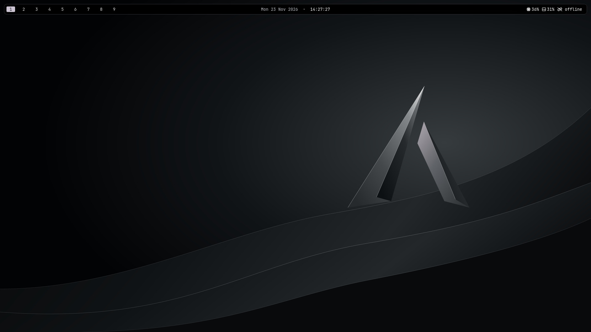

# archelinux

archelinux is an Arch-based distro for people who still think in i3 keybindings. Boot the USB, pick a disk and your tools, and log in to a SwayFX desktop with Zsh, tmux and Neovim. The configs are ordinary files in your home directory.

[Download 2.0.0](https://github.com/archelinux/archelinux/releases/tag/v2.0.0) · [Install guide](docs/getting-started.md) · [Build it yourself](docs/architecture.md)

The installer starts with XFS, optional LUKS encryption, and the Zen and LTS kernels. Keep the recommended workspace or clear the tool selection for a console install. The USB includes the archelinux packages. During installation, pacman downloads their Arch Linux dependencies from Arch mirrors.

## At the keyboard

- **Super+Enter** opens Foot. **Super+D** opens Fuzzel. Move between tiles with **Super+H/J/K/L**.
- Zsh starts with the Oh My Zsh `bureau` prompt. Use **Right** to accept a suggestion and **Esc Esc** to add `sudo`.
- Neovim runs LazyVim with `archevim`, a dark colorscheme with a black file tree. **Ctrl+H/J/K/L** moves between editor splits and tmux panes.
- Choose `gh`, GitHub notifications for Waybar, language servers, developer runtimes, or the NVIDIA CUDA bundle in the installer. You can also add a bundle later with pacman.

Upcoming builds use [Graphite](assets/graphite.svg), the project’s original wallpaper, available under [0BSD](assets/LICENSE.graphite). The Waybar theme draws on [okubax/dotfiles](https://github.com/okubax/dotfiles).

## Hardware reports

Tell us which GPU, kernel and display setup you used, especially for NVIDIA, multi-monitor setups or suspend. [Open an issue](https://github.com/archelinux/archelinux/issues).

archelinux is [GPL-3.0](LICENSE). Bundled software retains its upstream licenses.
